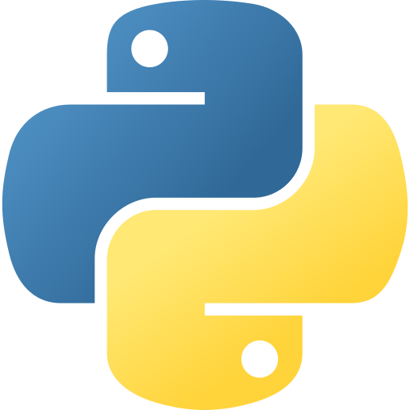
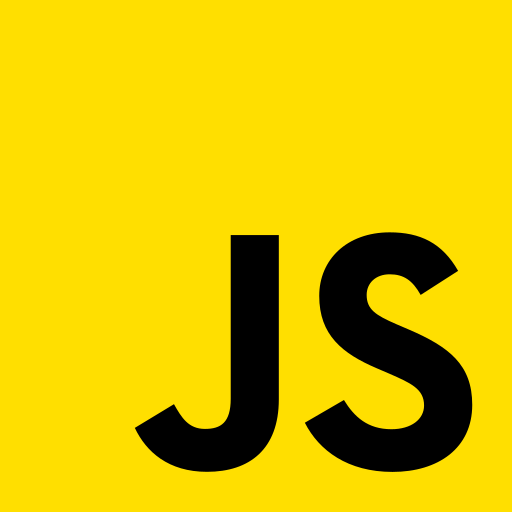
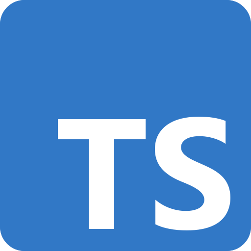
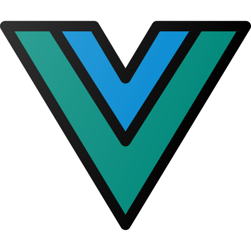
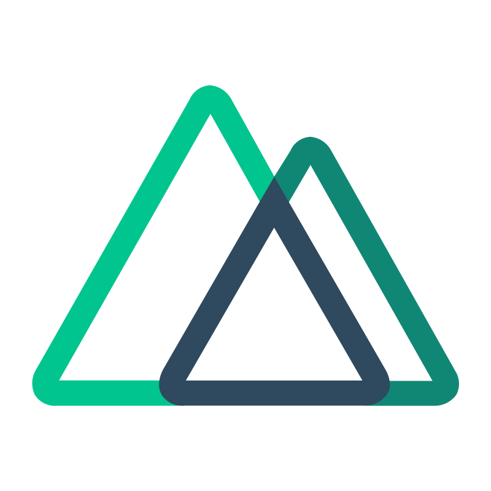
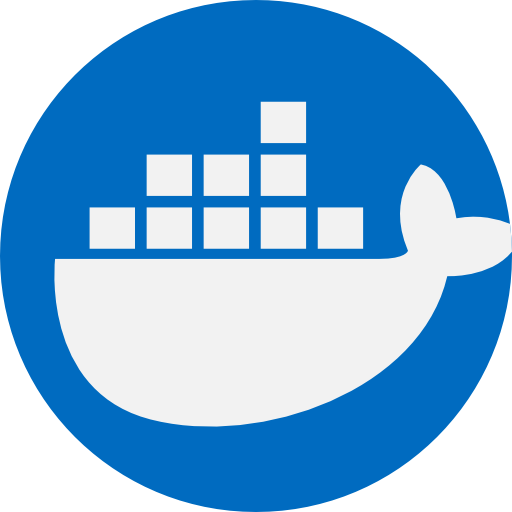
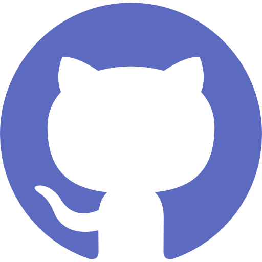

## Hi  my name is Denys

---

I'm a passionate software developer with experience in **full-stack development**, **backend APIs**, and **web application architecture**. I enjoy building efficient, scalable, and user-friendly solutions while constantly exploring new technologies.

## 🔧 Tech Stack

- **Backend:** Django + DRF, FastApi, NestJS
- **Frontend:** Vue.js, Nuxt.js, HTML, CSS, JavaScript
- **Databases:** PostgreSQL, MySQL
- **Authentication & APIs:** dj-rest-auth, djoser, OAuth (Google Login)
- **Microservices & Communication:** NestJS Microservices, TCP communication
- **DevOps & Tools:** Docker products, Git, GitHub, Swagger

## 🌱 I’m currently learning

- Advanced microservices communication
- Optimizing backend performance and scalability
- Frontend frameworks and 3D visualization techniques

## 📫 Contact Me

- Email: [yakymchukdenys45@gmail.com](mailto:yakymchukdenys45@gmail.com)
- LinkedIn: [LinkedIn link](www.linkedin.com/in/denys-yakymchuk-038791250)

---

*"Code is like humor. When you have to explain it, it’s bad."* 😄